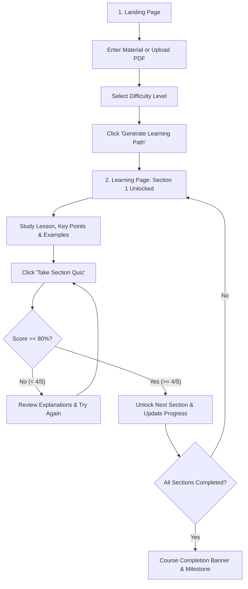

# LearnLens AI 🎓

> **Turn Any Material into Your Personal Learning Journey.**

LearnLens AI is an AI-powered personalized learning web application built with **Laravel**, **Bootstrap**, and **Google Gemini / Gemma**. It allows users to submit study materials, research papers, notes, or PDFs, and transforms them into a structured, progressive learning path with interactive lessons and mastery-gated chapter quizzes.

---

## 🌟 Key Features

- **Personalized Learning Paths**: Converts raw articles, notes, textbooks, or PDFs into digestible, structured chapters.
- **Mastery Gating (80% Passing Rule)**: Only Section 1 is unlocked initially. Subsequent sections unlock only after scoring at least **4 out of 5 (80%)** on the current chapter's quiz.
- **Interactive Quizzes**: 5 multiple-choice questions per module with instant scoring, contextual explanations, and unlimited retries.
- **Difficulty Adaptation**: Tailor content depth across **Beginner**, **Intermediate**, and **Advanced** tiers.
- **Flexible Material Input**: Paste text directly, choose from quick presets (*Quantum Computing*, *AI Ethics*, *Personal Finance*), or upload a PDF document.
- **Secure by Design**: API keys and quiz answers are never exposed to the frontend. All quiz validation is evaluated on the server.
- **Zero Database Setup**: Uses Laravel session storage to track progress temporarily—no database configuration required.
- **Dual Engine (Gemini / Gemma + Resilient Fallback)**: Connects to the Gemini API (`gemma-2-9b-it`) when configured, with a built-in text-deconstructing curriculum generator fallback.

---

## 🛠️ Technology Stack

| Component | Technology |
|---|---|
| **Backend Framework** | Laravel 11.x (PHP 8.3+) |
| **Frontend UI** | Laravel Blade, Bootstrap 5.3, Bootstrap Icons |
| **Interactivity** | Vanilla JavaScript (No heavy frameworks required) |
| **AI Model** | Google Generative Language API (`gemma-2-9b-it` / `gemini-1.5-flash`) |
| **Document Parsing** | `smalot/pdfparser` for PDF text extraction |
| **State Management** | Laravel Encrypted Session Storage |

---

## 📋 System Requirements

Ensure you have the following installed on your machine:
- **PHP** >= 8.2 (PHP 8.3 recommended)
- **Composer** (v2.x)
- **cURL** / OpenSSL extensions enabled in PHP

---

## 🚀 Setup Procedure

Follow these steps to set up and run LearnLens AI locally:

### 1. Clone the Repository
```bash
git clone https://github.com/adamuibrahim858/learnlen_ai.git
cd learnlen_ai
```

### 2. Install PHP Dependencies
```bash
composer install
```

### 3. Configure the Environment
Copy the `.env.example` file to create your `.env`:
```bash
cp .env.example .env
```

Generate the Laravel application key:
```bash
php artisan key:generate
```

### 4. Configure the Gemini API Key
Open `.env` and add your Google Gemini API key:
```env
GEMINI_API_KEY=your_gemini_api_key_here
GEMINI_MODEL=gemma-2-9b-it
```
> **Note**: If `GEMINI_API_KEY` is left blank, LearnLens AI will automatically utilize its intelligent local curriculum engine, guaranteeing 100% functionality even without an external API key!

### 5. Start the Application Server
Run the built-in development server:
```bash
php artisan serve --port=8000
```

Open your browser and navigate to:
**[http://localhost:8000](http://localhost:8000)**

---

## 📖 Step-by-Step User Procedure



### Step 1: Submit Learning Material
1. Navigate to the landing page at `http://localhost:8000`.
2. Choose one of the following methods to supply your content:
   - **Paste text**: Insert study notes, lecture transcripts, or articles into the textarea.
   - **Use a Preset**: Click one of the quick presets (*⚛️ Quantum Computing Basics*, *🤖 AI Ethics*, or *📈 Personal Finance*).
   - **Upload a PDF**: Click the PDF file input to upload any document (up to 12MB).

### Step 2: Select Difficulty & Generate
1. Pick your preferred target difficulty:
   - **Beginner**: Accessible foundational overview.
   - **Intermediate**: Practical concepts and balanced depth.
   - **Advanced**: In-depth analysis and technical rigor.
2. Click **"Generate Learning Path"**. The system processes the content and redirects to your tailored curriculum.

### Step 3: Study the Lesson Modules
1. Section 1 is unlocked and ready for study.
2. Review the structured lesson components:
   - **Lesson Explanation**: Step-by-step breakdown of core concepts.
   - **Key Points to Remember**: Concise takeaway bullets.
   - **Illustrative Example**: Practical real-world application.

### Step 4: Complete the Mastery Quiz
1. Click **"Take Section Quiz"**.
2. A modal displays 5 multiple-choice questions derived directly from that module.
3. Select your answers for all 5 questions and click **"Submit Assessment"**.

### Step 5: Review Results and Progression
- **If you score 4/5 (80%) or 5/5 (100%)**:
  - The module is marked **Mastered**.
  - The next module automatically unlocks.
  - The course progress bar advances.
- **If you score less than 4/5**:
  - Detailed feedback identifies correct/incorrect answers with explanations.
  - Click **"Try Again"** to retake the quiz until mastery is achieved.

### Step 6: Course Completion
- Once all sections are mastered, a celebratory completion banner appears with the option to reset and start a new learning journey.

---

## 🧪 Testing

LearnLens AI includes automated Feature tests covering the full application flow:

```bash
php artisan test
```

### Test Coverage includes:
- Landing page rendering and hero presence.
- Material and PDF input validation.
- AI curriculum generation and session storage.
- Session persistence and redirection.
- Locked/unlocked card states.
- Server-side quiz evaluation and failure gating (< 80%).
- Success unlocking progression (>= 80%).
- Session reset functionality.

### Code Style (Laravel Pint)
To format code according to standard Laravel PSR-12 style rules:
```bash
vendor/bin/pint
```

---

## 📂 Project Architecture

```
app/
├── Http/
│   └── Controllers/
│       └── LearningController.php    # Page routing, PDF extraction, session state & quiz scoring
└── Services/
    └── GeminiService.php             # Gemini/Gemma API integration + local fallback engine
config/
└── services.php                      # Gemini service credentials configuration
resources/
└── views/
    ├── layouts/
    │   └── app.blade.php             # Base layout (Bootstrap 5.3, icons, fonts)
    ├── landing.blade.php             # Page 1: Hero, inputs, difficulty & presets
    └── learning.blade.php            # Page 2: Curriculum cards, modal quiz & progress bar
routes/
└── web.php                           # Application routes
tests/
└── Feature/
    └── LearnLensTest.php             # Feature test suite (10 tests, 43 assertions)
```

---

## 📄 License

This project is open-sourced software licensed under the [MIT License](LICENSE).
